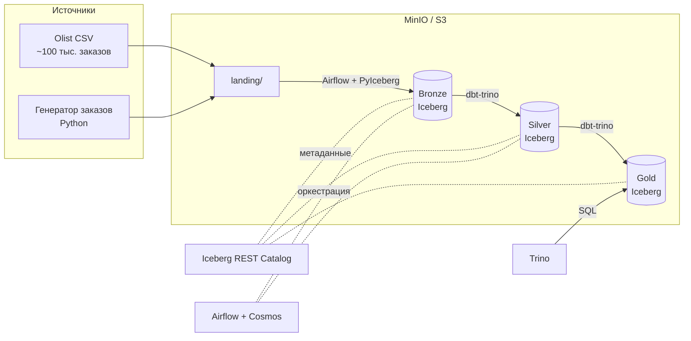

# Retail Lakehouse

Lakehouse-платформа для аналитики продаж маркетплейса на стеке **MinIO (S3) · Apache Iceberg · Trino · dbt · Apache Airflow · Cosmos**.

> **Статус:** в разработке. Отмеченные этапы ниже готовы, остальные в работе.

## Цель проекта

Собрать полный путь данных: от сырых файлов до аналитических витрин в lakehouse-архитектуре. Проект закрывает:

- хранение данных в объектном хранилище S3 в открытом табличном формате Iceberg;
- SQL-доступ к данным через Trino;
- слоистую модель Bronze → Silver → Gold на dbt;
- инкрементальную загрузку, дедупликацию и версионирование (SCD2);
- проверки качества данных;
- оркестрацию по расписанию в Airflow.

## Архитектура



| Компонент | Роль |
| --- | --- |
| MinIO | S3-совместимое хранилище файлов данных (Parquet) |
| Iceberg REST Catalog | Каталог таблиц: схемы, снапшоты, партиции |
| Trino | Распределённый SQL-движок для запросов к Iceberg |
| dbt (dbt-trino) | Трансформации Silver и Gold, тесты, документация |
| Airflow + Cosmos | Расписание загрузок; Cosmos запускает модели dbt как задачи Airflow |

## Данные

- **[Brazilian E-Commerce Public Dataset by Olist](https://www.kaggle.com/datasets/olistbr/brazilian-ecommerce)**: около 100 тыс. заказов за 2016–2018 годы, 9 связанных таблиц (заказы, позиции, платежи, клиенты, продавцы, товары, отзывы, геолокация).
- **Генератор ежедневных заказов на Python.** Создаёт новые заказы на основе существующих товаров и продавцов. В данные намеренно добавляются дубли, пропуски и опоздавшие записи, чтобы было на чём проверить дедупликацию и тесты качества.

## Слои данных

| Слой | Инструмент | Содержимое |
| --- | --- | --- |
| **Bronze** | Airflow + PyIceberg | Сырые данные как есть плюс технические поля `load_ts` и `source_file`; партиционирование по дню |
| **Silver** | dbt, incremental (merge) | Приведение типов, дедупликация через `row_number()`, snapshot цен товаров (SCD2) |
| **Gold** | dbt | Витрины: выручка по продавцам и категориям по дням, средний чек, топ товаров, динамика неделя к неделе |

**Проверки качества (dbt tests):** `unique`, `not_null`, `relationships` между заказами, товарами и продавцами, а также собственный тест «сумма позиций = сумма заказа».

## Структура репозитория

```
retail_lakehouse/
├── docker-compose.yml       # MinIO, Iceberg REST, Trino, Airflow
├── generator/               # генератор ежедневных заказов
├── airflow/
│   └── dags/                # DAG загрузки и обслуживания Iceberg
├── dbt/
│   ├── models/
│   │   ├── bronze/          # sources
│   │   ├── silver/
│   │   └── gold/
│   ├── snapshots/           # SCD2
│   └── tests/
├── trino/
│   └── catalog/             # конфигурация каталога Iceberg
└── README.md
```

## План работ

- [X] Инфраструктура в Docker: MinIO, Iceberg REST Catalog, Trino
- [ ] Загрузка датасета Olist в слой Bronze
- [ ] Генератор ежедневных заказов
- [ ] dbt: слой Silver (дедупликация, incremental, SCD2)
- [ ] dbt: слой Gold (витрины)
- [ ] Тесты качества данных dbt
- [ ] DAG Airflow с запуском dbt через Cosmos
- [ ] Обслуживание Iceberg: compaction, expire_snapshots
- [ ] Демонстрация: time travel, эволюция партиций, замер запроса с партиционированием и без
- [ ] Потоковая загрузка: Kafka → Spark Structured Streaming → Iceberg

## Запуск

> Инструкция появится после первого этапа.

```bash
git clone https://github.com/asddqk/retail_lakehouse.git
cd retail_lakehouse
docker compose up -d
```
