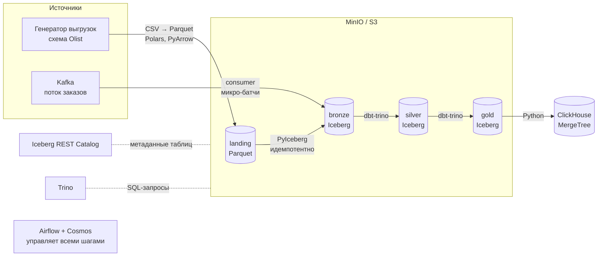

# Retail Lakehouse

[](https://github.com/asddqk/retail_lakehouse/actions/workflows/ci.yml)

Lakehouse-платформа для аналитики продаж интернет-магазина: от сырых выгрузок учётной системы
до витрин в Iceberg и ClickHouse. Весь стенд поднимается одной командой в Docker Compose.

**Стек:** MinIO (S3) · Apache Iceberg (REST Catalog) · Parquet · Trino · dbt · Apache Airflow 3 + Cosmos ·
ClickHouse · Kafka · Python (PyIceberg, PyArrow, Polars)

## Архитектура



| Компонент | Роль |
| --- | --- |
| MinIO | S3-совместимое хранилище: Parquet-файлы данных и метаданные Iceberg |
| Iceberg REST Catalog | Каталог таблиц (на SQLite, переживает перезапуск) |
| Trino | Распределённый SQL-движок поверх Iceberg; на нём работает dbt |
| dbt | Трансформации Silver и Gold, SCD2, тесты качества данных |
| Airflow 3 + Cosmos | Расписание; Cosmos превращает каждую модель dbt и её тесты в задачи Airflow |
| ClickHouse | Аналитическая БД для витрин (быстрые запросы для BI) |
| Kafka | Потоковая загрузка заказов в Bronze (профиль `streaming`) |

## Слои данных

| Слой | Чем строится | Что внутри |
| --- | --- | --- |
| **landing** | Python: Polars + PyArrow | Выгрузки как есть в Parquet (zstd), `s3://landing/<table>/load_date=YYYY-MM-DD/` |
| **bronze** | PyIceberg | Таблицы Iceberg, все поля строками + `load_date`, `load_ts`, `source_file`; партиции по `load_date` |
| **silver** | dbt, incremental `merge` | Типы, дедупликация (`row_number`), одна версия заказа, SCD2 цен |
| **gold** | dbt | Звезда: `fct_sales` + `dim_*`, витрины продаж, категорий, продавцов, топ товаров |
| **quality** | dbt | Карантин отбракованных строк и сводка качества по каждой загрузке |

### Данные

Генератор (`src/retail/generator.py`) каждый день отдаёт выгрузку в **схеме датасета
[Olist](https://www.kaggle.com/datasets/olistbr/brazilian-ecommerce)**: заказы, позиции, платежи,
покупатели, продавцы, товары и прайс. Как настоящая учётная система, он присылает не только новые заказы,
но и **обновления статусов** старых заказов (CDC), а также «грязь», на которой проверяется пайплайн:

* точные дубли строк (~2% заказов);
* заказы без `customer_id` (~0,5%) → уходят в карантин `quality.dq_rejected_rows`;
* опоздавшие записи: ~3% заказов приходят через 1–3 дня после покупки;
* расхождение суммы платежей и позиций (~0,3%) → предупреждение теста dbt;
* изменения цен (~раз в 40 дней на товар) → история SCD2.

Генерация детерминирована: одна и та же дата всегда даёт одни и те же файлы. Реальные CSV Olist
можно загрузить вместо сгенерированных (см. ниже).

## Что реализовано

- **Идемпотентная загрузка.** Повторный запуск за дату перезаписывает партицию `load_date` (overwrite с фильтром), дублей не появляется. Покрыто тестом.
- **Schema evolution.** Новая колонка в источнике автоматически добавляется в таблицу Bronze.
- **Инкрементальные модели.** `merge` по ключу в Trino/Iceberg; результат совпадает с полной пересборкой (проверено).
- **SCD2 двумя способами.** `silver_product_prices_scd2` восстанавливает полную историю цен из выгрузок (работает после backfill), а `dbt snapshot` фиксирует изменения в момент запуска.
- **Point-in-time join.** `fct_sales` берёт цену из прайса, действовавшую в момент покупки, и считает скидку.
- **Data Quality.** 39 тестов dbt (unique, not_null, relationships, accepted_values и собственные: сверка выручки витрины с фактом, отсутствие пересечений интервалов SCD2, совпадение платежей с позициями) плюс карантин и сводка качества.
- **Стриминг.** Kafka → консьюмер → Iceberg микро-батчами; offset фиксируется после записи (at-least-once), дубли убирает Silver.
- **Обслуживание Iceberg.** Отдельный DAG раз в неделю: compaction (`optimize`), `expire_snapshots`, `remove_orphan_files`.
- **ClickHouse.** Витрины в MergeTree с партициями по месяцам и ключом сортировки под типовые фильтры.
- **Бенчмарки.** Замеры времени, памяти и CPU: CSV vs Parquet, отсечение партиций в Trino, Trino vs ClickHouse.
- **CI.** GitHub Actions на каждый push: pytest и `dbt build` всех моделей и тестов на DuckDB (S3 эмулирует moto, каталог Iceberg на SQLite).

## Запуск

Нужен Docker Desktop с 6+ ГБ памяти (Settings → Resources). Основной стенд занимает около 5 ГБ.

```bash
git clone https://github.com/asddqk/retail_lakehouse.git
cd retail_lakehouse
docker compose up -d --build        # первый раз 10–15 минут: собирается образ Airflow
docker compose ps                   # все сервисы в статусе running
```

Создать бакеты и схемы и загрузить историю за месяц:

```bash
docker compose exec airflow python -m retail.cli init
docker compose exec airflow python -m retail.cli backfill --start 2026-10-01 --end 2026-11-07
```

Дальше в Airflow (http://localhost:8081) включить DAG `retail_daily` и запустить его кнопкой ▶.
Первый запуск строит все слои: Silver, Gold, тесты и выгрузку в ClickHouse.

| Интерфейс | Адрес | Доступ |
| --- | --- | --- |
| Airflow | http://localhost:8081 | без логина |
| Trino | http://localhost:8080 | любой пользователь, без пароля |
| ClickHouse | http://localhost:8123/play | admin / password |

Примеры запросов для DBeaver: [`sql/01_explore_lakehouse.sql`](sql/01_explore_lakehouse.sql) (Trino)
и [`sql/02_clickhouse.sql`](sql/02_clickhouse.sql).

### Стриминг

```bash
docker compose --profile streaming up -d     # Kafka, продюсер и консьюмер
docker compose logs -f stream-consumer       # батчи пишутся в bronze.orders_stream
```

Следующий запуск DAG подхватит заказы из потока в `silver_orders`. Если памяти мало,
стриминг лучше запускать отдельно от DAG.

### Бенчмарки

```bash
docker compose exec airflow python /opt/airflow/benchmarks/run_benchmarks.py
```

Результаты сохраняются в [`benchmarks/results.md`](benchmarks/results.md).

### Реальный датасет Olist

Скачать CSV с Kaggle в `data/olist/`, затем:

```bash
docker compose exec airflow python -m retail.cli land --date 2018-09-01 --source /opt/airflow/data/olist
docker compose exec airflow python -m retail.cli bronze --date 2018-09-01
```

Имена файлов Olist (`olist_orders_dataset.csv` и др.) сопоставляются с таблицами автоматически.

## Структура

```
retail_lakehouse/
├── docker-compose.yml          # весь стенд
├── airflow/
│   ├── Dockerfile              # Airflow 3 + dbt (отдельный venv) + зависимости
│   └── dags/
│       ├── retail_daily.py         # ежедневный пайплайн (Cosmos)
│       └── iceberg_maintenance.py  # compaction и очистка снапшотов
├── src/retail/
│   ├── generator.py            # генератор выгрузок (схема Olist)
│   ├── landing.py              # CSV → Parquet в S3
│   ├── bronze.py               # landing → Iceberg (PyIceberg)
│   ├── clickhouse_export.py    # gold → ClickHouse
│   ├── maintenance.py          # обслуживание Iceberg через Trino
│   ├── streaming/              # Kafka producer / consumer
│   └── cli.py                  # командная строка
├── dbt/retail_lakehouse/
│   ├── models/silver/          # очистка, дедупликация, SCD2
│   ├── models/gold/            # звезда и витрины
│   ├── models/quality/         # карантин и сводка качества
│   ├── snapshots/              # dbt snapshot (SCD2)
│   └── tests/                  # собственные тесты качества
├── clickhouse/init.sql         # таблицы ClickHouse
├── benchmarks/                 # бенчмарки
├── sql/                        # примеры запросов
├── tests/                      # pytest
└── .github/workflows/ci.yml    # CI
```

## Решения и компромиссы

- **Каталог Iceberg на SQLite.** Для стенда достаточно и не требует отдельной БД; коммиты идут по одному (`threads: 1` в dbt, `max_active_tasks: 2` в DAG). В продакшене — PostgreSQL, Nessie или Polaris.
- **Bronze — все поля строками.** Ошибка типа в источнике не роняет загрузку: строка доезжает до Bronze, а в Silver отбраковывается в карантин.
- **Консьюмер Kafka на Python, а не Spark.** На ноутбуке Spark слишком тяжёл; гарантии те же (микро-батчи, at-least-once, коммит offset после записи). Следующий шаг — Spark Structured Streaming.
- **Airflow в режиме standalone.** Один контейнер вместо четырёх, чтобы стенд помещался в память ноутбука.

## Устранение неполадок

- **`docker compose ps` показывает перезапуски `iceberg-rest`.** Посмотреть `docker compose logs iceberg-rest`. В крайнем случае удалить строку `CATALOG_URI` в `docker-compose.yml`: каталог будет храниться в памяти.
- **Airflow не видит DAG.** `docker compose logs airflow | grep -i error`; ошибки импорта видны вверху страницы DAGs.
- **Не хватает памяти.** Остановить ненужное: `docker compose stop clickhouse` или не запускать профиль `streaming`.

---

Диана Бикташова · [biktashovad@yandex.ru](mailto:biktashovad@yandex.ru)
